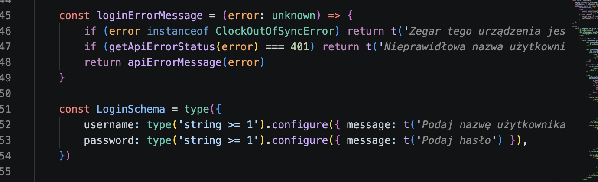

# Intl Peek

Shows translations in place of keys for [next-intl](https://next-intl.dev) and [use-intl](https://www.npmjs.com/package/use-intl). One small file, no runtime dependencies: a lightweight alternative to i18n-ally.



- **Inline:** `t('login.submit')` reads as `t('Zaloguj się')`. On the line with the cursor, the key comes back so you can edit it.
- **Hover:** shows the value in every locale and marks the missing ones.
- **Go to definition (F12):** opens the key in the message file.
- **Completion:** suggests keys inside `t('...')`, scoped to the namespace.
- **Warnings:** marks a key that is missing in any locale.
- **Progress:** the Translations section in the Explorer shows how many keys of the default locale each locale has. Expand a locale to see its missing keys, and click a key to open it in the default locale.

## How keys are found

Intl Peek reads the translator bindings in each file:

```ts
const t = useTranslations('auth')                 // t('login.submit') -> auth.login.submit
const t = await getTranslations({ namespace: 'auth' })
const t = useTranslations()                       // t('auth.login.submit')
```

Each call uses the nearest binding above it, so two components in one file can bind `t` to different namespaces. The `t.rich`, `t.markup`, `t.raw` and `t.has` methods work too. Keys built at runtime (template strings, variables) are skipped.

## Message files

By default, Intl Peek uses any `locales` or `messages` folder in the workspace, in one of these layouts:

```
messages/en.json            one file per locale
locales/en/common.json      one file per locale and namespace
```

## Settings

| Setting                  | Default | Description                                                                             |
| ------------------------ | ------- | --------------------------------------------------------------------------------------- |
| `intl-peek.localesPath`  | `""`    | Folder with the message files, relative to the workspace root. Empty: auto-detect.       |
| `intl-peek.displayLocale`| `"pl"`  | Default locale: shown inline, in completion and as the base for progress. `pl` also matches `pl-PL` or `pl_PL`. If none is found, the first locale is used. |

## Development

```sh
bun install
bun run check     # types and tests
bun run package   # builds intl-peek-<version>.vsix
```

Release: bump `version` in `package.json`, add a `CHANGELOG.md` entry, then run the Release VS Code Extension workflow (`gh workflow run publish-extension.yml`). It publishes to the Marketplace, to Open VSX when the `OVSX_PAT` secret is set, and creates the GitHub release with the `.vsix`.
